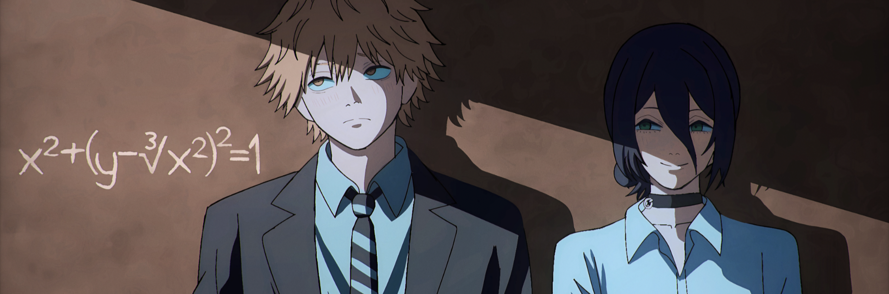

	

 

<h1 align="center">Hi, I'm Akash.</h1>

<em>student :3</em>

	learning to turn curiousity 
	into code

	<a href="https://www.linkedin.com/in/akashhh7">linkedin</a>
	&nbsp;&nbsp;·&nbsp;&nbsp;
	<a href="mailto:4126akash@gmail.com">email</a>
	&nbsp;&nbsp;·&nbsp;&nbsp;
	<a href="https://www.instagram.com/akashhh_m7">instagram</a>

 

<h3>currently</h3>

strenthening c++ fundamentals | exploring competative programing | trying open source contributions

 

<h3>learning</h3>

  <code>c++</code> ·
  <code>problem-solving</code> ·
  <code>linux</code> ·
  <code>web development</code>

<small>where logic meets competition</small>

 

	<a href="https://leetcode.com/akashhh7">leetcode</a>
	&nbsp;&nbsp;·&nbsp;&nbsp;
	<a href="https://codeforces.com/profile/kashhh-m7">codeforces</a>
	&nbsp;&nbsp;·&nbsp;&nbsp;
	<a href="https://www.codechef.com/users/akashhh7">codechef</a>

 

<small><em>soewhere between logic and creativity</em></small>
